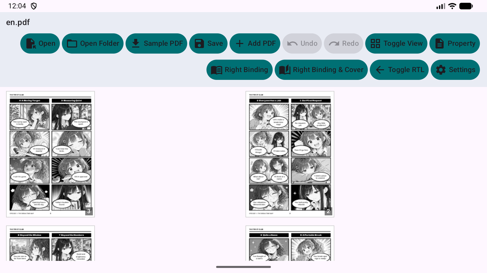
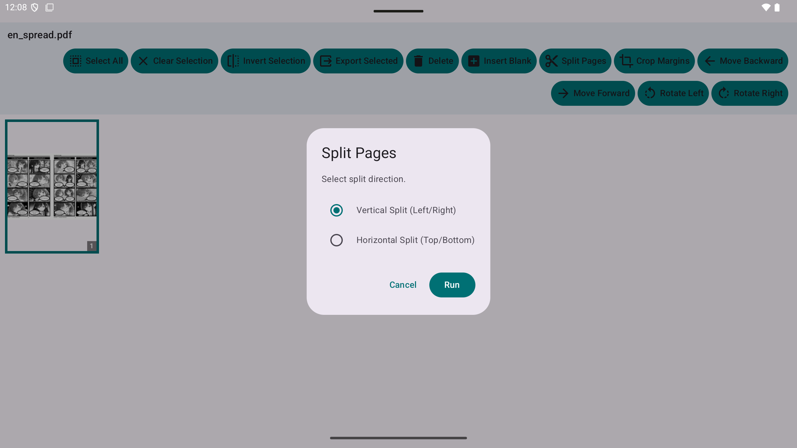
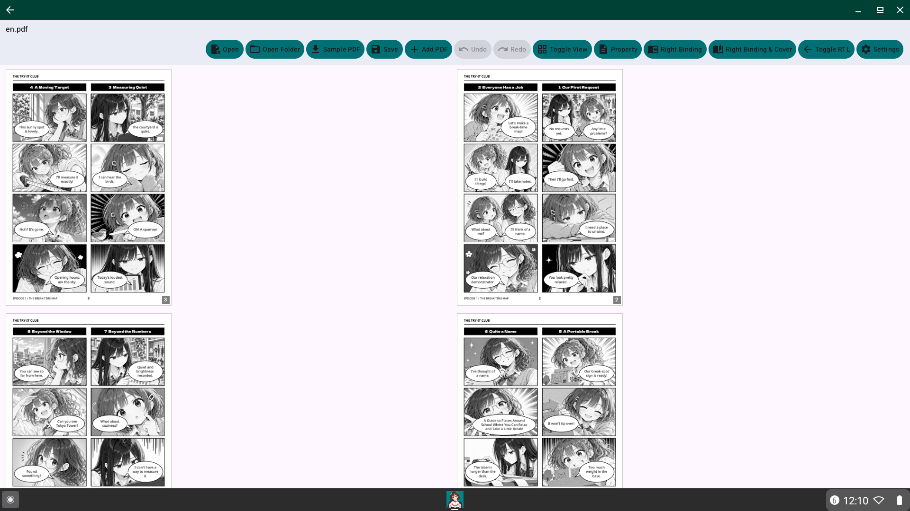

# Mihiraki PDF Utility (Android)

A powerful and intuitive PDF utility for Android, specializing in organizing work, studies, submission documents, scanned books, and manga with **Mihiraki (two-page spread view)**.

[**日本語サイト**](https://tyamada.github.io/MihirakiPDFUtility_Android/index_ja.html) | [**English Website**](https://tyamada.github.io/MihirakiPDFUtility_Android/) | [**日本語 README (README_ja.md)**](README_ja.md)

## Release candidate

Candidate: <!-- current-app-version:start -->1.2.7 (23)<!-- current-app-version:end -->. Closed-test publication and Play update verification are pending.

Sample PDFs can be sorted from Chapter 1 or the latest chapter. The selected order is retained after restarting the app. Downloads use this app's own published sample files.

For developers, `scripts/run_device_tests_and_save.py --serial <serial>` only collects installed-app information. Debug tests require `--mode debug` on a dedicated device; Play installations are protected. This tool does not certify manual checks or rewrite the verification list. See [the release preparation report](docs/CLOSED_TEST_RELEASE_PROGRESS_1.2.7_23.ja.md).

## 🚀 Key Features

| Feature | Description |
| :--- | :--- |
| 📖 **Mihiraki View** | View two pages side-by-side. Full support for Right-to-Left (RTL) reading directions for manga and Japanese books. |
| ✂️ **Smart Splitting** | Split double-page spreads into individual pages. Supports vertical and horizontal splitting. |
| 🔀 **Drag & Drop Reordering** | Easily organize your PDF by dragging and dropping thumbnails. Intuitive page management. |
| ➕ **Merge & Append** | Combine multiple PDF files into one, or add pages to existing documents. |
| 🖥️ **Adaptive Menu & Customization** | Adaptive layout: horizontal menu bar at widths of 840 dp or more, and a categorized overflow menu on smaller screens, plus customizable toolbar buttons via Options. |
| 🔒 **Security & Privacy** | Dedicated in-app privacy policy, password protection, metadata editing, automatic active content sanitization, and local audit logs. |
| 🌟 **Interactive Tutorial** | Guided step-by-step tutorial screen for first-time users with instant sample PDF trial and re-triggerable help. |
| 🔍 **Diagnostics & Benchmarks** | Run in-app comprehensive diagnostics and benchmark tests using dynamic test PDFs, and review local audit logs (24-hour retention, offline/privacy-protected). |
| 💻 **Cross-Device Support** | Optimized for Smartphones, Tablets, Foldables, and ChromeOS (desktop experience). |
| 🔄 Play Store Update Check | Automatic update check on launch and manual check in the version dialog with rate limiting, with a dynamic toolbar update button when an update is available. |

### Feature Showcase

### Visual Examples

Explore how the application functions across different device types:

| Device | View | Image |
| :--- | :--- | :--- |
| **Smartphone** | Spread View |  |
| **Tablet** | Smart Splitting |  |
| **ChromeOS** | Desktop Interface |  |

## 🌐 Multi-language Support

14 languages supported, including Italian, Japanese, English, Korean, Chinese, German, French, Spanish, Portuguese, Vietnamese, Filipino, Nepali, and Indonesian.

## Sample PDFs

You can download and test sample PDFs (Manga) to try out Mihiraki PDF Utility:

- [THE TRY-IT CLUB EPISODE 1: THE BREAK-TIME MAP (English) - Komairo Hiyori](https://github.com/tyamada/MihirakiPDFUtility_Android/raw/main/sample/tameshibu_episode1_2_en.pdf)
- [THE TRY-IT CLUB EPISODE 2: ROOM TO GROW (English) - Komairo Hiyori](https://github.com/tyamada/MihirakiPDFUtility_Android/raw/main/sample/tameshibu_episode2_2_en.pdf)
- [ためし部 第１話 ひと息マップ (Japanese) - こまいろ日和](https://github.com/tyamada/MihirakiPDFUtility_Android/raw/main/sample/tameshibu_episode1_2_ja.pdf)
- [ためし部 第２話 机、ひろがる。 (Japanese) - こまいろ日和](https://github.com/tyamada/MihirakiPDFUtility_Android/raw/main/sample/tameshibu_episode2_2_ja.pdf)
- [해봄부 제1화 한숨 돌림 지도 (Korean) - 코마이로 히요리](https://github.com/tyamada/MihirakiPDFUtility_Android/raw/main/sample/tameshibu_episode1_2_ko.pdf)
- [해봄부제2화 책상이 넓어지다 (Korean) - 코마이로 히요리](https://github.com/tyamada/MihirakiPDFUtility_Android/raw/main/sample/tameshibu_episode2_2_ko.pdf)
- [试试社 第1话 歇口气地图 (Chinese (Simplified)) - 小真彩日和](https://github.com/tyamada/MihirakiPDFUtility_Android/raw/main/sample/tameshibu_episode1_2_zh_cn.pdf)
- [试试社 第2话 桌子变大了 (Chinese (Simplified)) - 小真彩日和](https://github.com/tyamada/MihirakiPDFUtility_Android/raw/main/sample/tameshibu_episode2_2_zh_cn.pdf)
- [試試社 第1話 (Chinese (Traditional)) - 小舞樓日和](https://github.com/tyamada/MihirakiPDFUtility_Android/raw/main/sample/tameshibu_episode1_2_zh_tw.pdf)
- [試試社 第2話 (Chinese (Traditional)) - 小舞樓日和](https://github.com/tyamada/MihirakiPDFUtility_Android/raw/main/sample/tameshibu_episode2_2_zh_tw.pdf)
- [DER PROBIERCLUB FOLGE 1 (German) - Komairo Hiyori](https://github.com/tyamada/MihirakiPDFUtility_Android/raw/main/sample/tameshibu_episode1_2_de.pdf)
- [DER PROBIERCLUB FOLGE 2 (German) - Komairo Hiyori](https://github.com/tyamada/MihirakiPDFUtility_Android/raw/main/sample/tameshibu_episode2_2_de.pdf)
- [LE CLUB DES ESSAIS EPISODE 1 (French) - Komairo Hiyori](https://github.com/tyamada/MihirakiPDFUtility_Android/raw/main/sample/tameshibu_episode1_2_fr.pdf)
- [LE CLUB DES ESSAIS EPISODE 2 (French) - Komairo Hiyori](https://github.com/tyamada/MihirakiPDFUtility_Android/raw/main/sample/tameshibu_episode2_2_fr.pdf)
- [EL CLUB DE PRUEBA EPISODIO 1 (Spanish) - Komairo Hiyori](https://github.com/tyamada/MihirakiPDFUtility_Android/raw/main/sample/tameshibu_episode1_2_es.pdf)
- [EL CLUB DE PRUEBA EPISODIO 2 (Spanish) - Komairo Hiyori](https://github.com/tyamada/MihirakiPDFUtility_Android/raw/main/sample/tameshibu_episode2_2_es.pdf)
- [IL CLUB DI PROVA EPISODIO 1 (Italian) - Komairo Hiyori](https://github.com/tyamada/MihirakiPDFUtility_Android/raw/main/sample/tameshibu_episode1_2_it.pdf)
- [IL CLUB DI PROVA EPISODIO 2 (Italian) - Komairo Hiyori](https://github.com/tyamada/MihirakiPDFUtility_Android/raw/main/sample/tameshibu_episode2_2_it.pdf)
- [O CLUBE DE TESTE EPISÓDIO 1 (Portuguese) - Komairo Hiyori](https://github.com/tyamada/MihirakiPDFUtility_Android/raw/main/sample/tameshibu_episode1_2_pt.pdf)
- [O CLUBE DE TESTE EPISÓDIO 2 (Portuguese) - Komairo Hiyori](https://github.com/tyamada/MihirakiPDFUtility_Android/raw/main/sample/tameshibu_episode2_2_pt.pdf)
- [CÂU LẠC BỘ THỬ NGHIỆM TẬP 1 (Vietnamese) - Komairo Hiyori](https://github.com/tyamada/MihirakiPDFUtility_Android/raw/main/sample/tameshibu_episode1_2_vi.pdf)
- [CÂU LẠC BỘ THỬ NGHIỆM TẬP 2 (Vietnamese) - Komairo Hiyori](https://github.com/tyamada/MihirakiPDFUtility_Android/raw/main/sample/tameshibu_episode2_2_vi.pdf)
- [KLUB PERCOBAAN EPISODE 1 (Indonesian) - Komairo Hiyori](https://github.com/tyamada/MihirakiPDFUtility_Android/raw/main/sample/tameshibu_episode1_2_id.pdf)
- [KLUB PERCOBAAN EPISODE 2 (Indonesian) - Komairo Hiyori](https://github.com/tyamada/MihirakiPDFUtility_Android/raw/main/sample/tameshibu_episode2_2_id.pdf)
- [ANG SUBOK CLUB EPISODE 1 (Filipino) - Komairo Hiyori](https://github.com/tyamada/MihirakiPDFUtility_Android/raw/main/sample/tameshibu_episode1_2_fil.pdf)
- [ANG SUBOK CLUB EPISODE 2 (Filipino) - Komairo Hiyori](https://github.com/tyamada/MihirakiPDFUtility_Android/raw/main/sample/tameshibu_episode2_2_fil.pdf)
- [परीक्षण क्लब एपिसोड १ (Nepali) - Komairo Hiyori](https://github.com/tyamada/MihirakiPDFUtility_Android/raw/main/sample/tameshibu_episode1_2_ne.pdf)
- [परीक्षण क्लब एपिसोड २ (Nepali) - Komairo Hiyori](https://github.com/tyamada/MihirakiPDFUtility_Android/raw/main/sample/tameshibu_episode2_2_ne.pdf)
- [THE TRY-IT CLUB EPISODE 3 (English) - Komairo Hiyori](https://github.com/tyamada/MihirakiPDFUtility_Android/raw/main/sample/tameshibu_episode3_en.pdf)
- [ためし部 第３話 (Japanese) - こまいろ日和](https://github.com/tyamada/MihirakiPDFUtility_Android/raw/main/sample/tameshibu_episode3_ja.pdf)
- [해봄부 제3화 (Korean) - 코마이로 히요리](https://github.com/tyamada/MihirakiPDFUtility_Android/raw/main/sample/tameshibu_episode3_ko.pdf)
- [试试社 第3话 (Chinese (Simplified)) - 小真彩日和](https://github.com/tyamada/MihirakiPDFUtility_Android/raw/main/sample/tameshibu_episode3_zh_cn.pdf)
- [試試社 第3話 (Chinese (Traditional)) - 小舞樓日和](https://github.com/tyamada/MihirakiPDFUtility_Android/raw/main/sample/tameshibu_episode3_zh_tw.pdf)

### Sample PDF License (CC BY 4.0)

"The Try-It Club" Episodes 1 & 2
© 2026 Komairo Hiyori

Parts of this work for which the publisher holds copyright and other licensing rights are provided under the [Creative Commons Attribution 4.0 International License (CC BY 4.0)](https://creativecommons.org/licenses/by/4.0/).

When reusing this work, please display the work title, author name "Komairo Hiyori", the source of the original work, and a link to the license, and clearly indicate if any changes were made.

Generative AI was used in the production of text and images, as well as the translation of this work. Materials with rights held by third parties, such as fonts, are subject to their respective licenses. Nothing in this license constitutes a restriction on the use of material that is not protected by copyright or similar laws.

## Technical Stack

*   **UI**: Jetpack Compose (Material 3)
*   **Architecture**: MVVM (ViewModel, StateFlow)
*   **PDF Processing**: [PdfBox-Android](https://github.com/TomRoush/PdfBox-Android)
*   **Language**: Kotlin

## License

Apache License 2.0

## Release & Documentation Rules

Before building the App Bundle, ensure that `README.md`, `LICENSE`, `docs/*.html`, and `store_listing/metadata*.txt` are updated in accordance with the latest specifications. See [RELEASE_RULES.md](RELEASE_RULES.md) for details. Automated pre-bundle checks are enforced via Gradle (`preBundleDocumentationCheck`).
