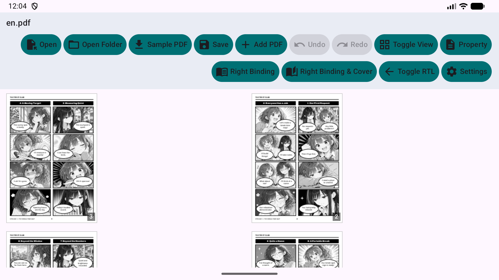
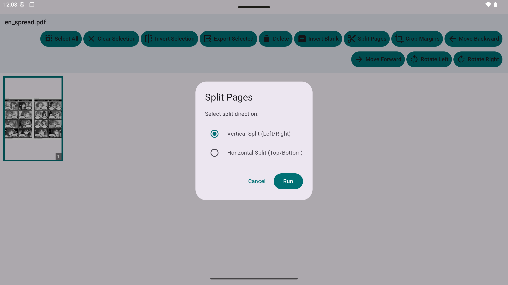
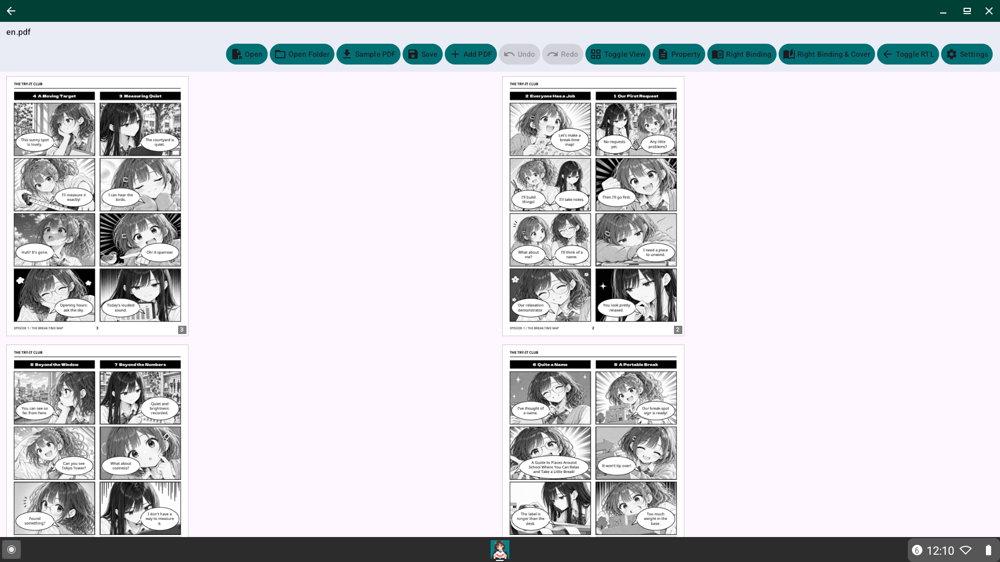

# Mihiraki PDF Utility (Android)

Production is not publicly released. See the [publication-readiness and X test-announcement record (Japanese)](docs/PRODUCTION_DISTRIBUTION_PLAN_2026-11-15.ja.md) for the November 23, 2026 check.

[](https://github.com/tyamada/MihirakiPDFUtility_Android/releases/tag/v1.2.16-sideload-test.1)
[](LICENSE)

A powerful and intuitive PDF utility for Android, specializing in organizing work, studies, submission documents, scanned books, and manga with **Mihiraki (two-page spread view)**.

[**日本語サイト**](https://tyamada.github.io/MihirakiPDFUtility_Android/index_ja.html) | [**English Website**](https://tyamada.github.io/MihirakiPDFUtility_Android/) | [**日本語 README (README_ja.md)**](README_ja.md)


## Video guides

These videos are in English and open on YouTube.

- [Tutorial playlist (5 videos)](https://www.youtube.com/playlist?list=PLa-QGEwHSDRo)

## Sideload Trial APK (Pre-release)

For devices without Google Play or users who want to test direct APK installation, a trial sideload APK with `SHA256SUMS` and signing certificate fingerprint is available on [GitHub Releases (`v1.2.16-sideload-test.1`)](https://github.com/tyamada/MihirakiPDFUtility_Android/releases/tag/v1.2.16-sideload-test.1).

- Uses a separate package ID (`com.takumayamada22.pdfutility.sideload`), so it can coexist alongside the Google Play edition without overwriting its data.
- All PDF editing features and the free Koyomi badge work identically; optional Play support purchases and Play in-app updates are disabled.

## Latest closed-test release

Version: <!-- current-app-version:start -->1.2.16 (32)<!-- current-app-version:end -->. The 1.2.16 release fixes duplicate PDF extensions in save suggestions and clipped toolbar labels. The app loads the latest validated sample catalog, falling back to the saved catalog or bundled samples when unavailable. Verified downloaded PDFs are retained. The free Koyomi badge is awarded automatically through December 31, 2027 (JST); acquired badges remain after the deadline. Its notification is dismissed manually, and App info shows an enlarged badge and description. Alpha 1.2.16 (32) was published to selected testers on November 25, 2026 (JST), and Production 1.2.16 (32) is currently under Google Play review for 6 initial regions.

The samples cover 14 languages and 17 language/region variants, with three episodes each. Native and English region names are sorted by English name. Episode order is retained after restarting the app.

[Release report](docs/CLOSED_TEST_RELEASE_PROGRESS_1.2.9_25.ja.md) · [Device retest checklist](docs/CLOSED_TEST_DEVICE_CHECKLIST_1.2.9_25.ja.md).

## 🚀 Key Features

| Feature | Description |
| :--- | :--- |
| 📖 **Mihiraki View** | View two pages side-by-side. Full support for Right-to-Left (RTL) reading directions for manga and Japanese books. |
| ✂️ **Smart Splitting** | Split double-page spreads into individual pages. Supports vertical and horizontal splitting. |
| 🔀 **Drag & Drop Reordering** | Easily organize your PDF by dragging and dropping thumbnails. Intuitive page management. |
| ➕ **Merge & Append** | Combine multiple PDF files into one, or add pages to existing documents. |
| 🖥️ **Adaptive Menu & Customization** | Adaptive layout: horizontal menu bar at widths of 840 dp or more, and a categorized, scrollable bottom sheet menu on smaller screens, plus customizable toolbar buttons via Options. |
| 🔒 **Security & Privacy** | Dedicated in-app privacy policy, password protection, metadata editing, automatic active content sanitization, and local audit logs. |
| 🌟 **Interactive Tutorial** | Guided step-by-step tutorial screen for first-time users with instant sample PDF trial and re-triggerable help. |
| 🔍 **Diagnostics & Benchmarks** | Run in-app comprehensive diagnostics and benchmark tests using dynamic test PDFs, and review local audit logs (24-hour retention, offline/privacy-protected). |
| 💻 **Cross-Device Support** | Optimized for Smartphones, Tablets, Foldables, and ChromeOS (desktop experience). |
| 🔄 Play Store Update Check | Automatic update check on launch and manual check in the version dialog with rate limiting, with a dynamic toolbar update button when an update is available. |

### Feature Showcase


### Visual Examples

Explore how the application functions across different device types:

| Device | View | Image |
| :--- | :--- | :--- |
| **Smartphone** | Spread View |  |
| **Tablet** | Smart Splitting |  |
| **ChromeOS** | Desktop Interface |  |

## 🌐 Multi-language Support

14 languages supported, including Italian, Japanese, English, Korean, Chinese, German, French, Spanish, Portuguese, Vietnamese, Filipino, Nepali, and Indonesian.

## Sample PDFs

You can download and test sample PDFs (Manga) to try out Mihiraki PDF Utility:

51 PDFs in 14 languages and 17 language/region variants, with three episodes each. Spain and Latin America, Brazil and Portugal, and Taiwan and Hong Kong have separate filters. The Hong Kong edition uses standard written Chinese, not colloquial Cantonese. Downloads are verified against their expected size and SHA-256; older PDFs are retained.

The links below are sorted by English language name, then Episode 1–3.

[Sample PDF downloads](https://tyamada.github.io/manga-prompt-kit/samples/en/)

### Sample PDF License (CC BY 4.0)

"The Try-It Club" Episodes 1–3
© 2026 Komairo Hiyori

Parts of this work for which the publisher holds copyright and other licensing rights are provided under the [Creative Commons Attribution 4.0 International License (CC BY 4.0)](https://creativecommons.org/licenses/by/4.0/).

When reusing this work, please display the work title, author name "Komairo Hiyori", the source of the original work, and a link to the license, and clearly indicate if any changes were made.

Generative AI was used in the production of text and images, as well as the translation of this work. Materials with rights held by third parties, such as fonts, are subject to their respective licenses. Nothing in this license constitutes a restriction on the use of material that is not protected by copyright or similar laws.

## Technical Stack

*   **UI**: Jetpack Compose (Material 3)
*   **Architecture**: MVVM (ViewModel, StateFlow)
*   **PDF Processing**: [PdfBox-Android](https://github.com/TomRoush/PdfBox-Android)
*   **Language**: Kotlin

## Getting started

### Development setup, build and installation

- JDK 21. The Gradle daemon selects JetBrains JDK 21; the toolchain resolver downloads it if needed.
- Android SDK Platform 36, Build Tools 36.0.0 and Platform Tools.
- For IDE use, select Android Studio compatible with this repository's Gradle/AGP versions.
- Install the SDK using Android Studio's SDK Manager or the [official command-line tools](https://developer.android.com/tools/sdkmanager), and accept the SDK licenses.

```bash
git clone https://github.com/tyamada/MihirakiPDFUtility_Android.git
cd MihirakiPDFUtility_Android
# Set JAVA_HOME to JDK 21 and ANDROID_HOME to your Android SDK directory.
sdkmanager "platforms;android-36" "build-tools;36.0.0" "platform-tools"
sdkmanager --licenses
./gradlew assembleDebug lintPlayDebug lintSideloadDebug testPlayDebugUnitTest testSideloadDebugUnitTest
# Connect one test device with USB debugging enabled, or start one emulator.
./gradlew installPlayDebug
```

Use `gradlew.bat` on Windows. Set the SDK location through `ANDROID_HOME` or `sdk.dir=/absolute/path/to/Android/sdk` in the ignored `local.properties`. In Android Studio, open the project, sync Gradle and select Run. Android 8.0 (API 26) or later is required.

The Debug APKs are `app/build/outputs/apk/play/debug/app-play-debug.apk` (and `app/build/outputs/apk/sideload/debug/app-sideload-debug.apk` for the sideload flavor). Debug builds use an automatically generated development key; the author's signing key is unnecessary. A Debug APK cannot replace the Play app with the same application ID and a different signature. Use a dedicated test device.

### Release signing

Generate your own distribution key. The author's private key is not distributed.

```bash
keytool -genkeypair -v -keystore /absolute/private/path/release-key.jks -alias release -keyalg RSA -keysize 3072 -validity 10000
```

Enter passwords interactively. Add the following to the ignored `local.properties`, replacing password placeholders with your own values:

```properties
signing.storeFile=/absolute/private/path/release-key.jks
signing.storePassword=YOUR_STORE_PASSWORD
signing.keyAlias=release
signing.keyPassword=YOUR_KEY_PASSWORD
```

Run `./gradlew bundlePlayRelease` to create `app/build/outputs/bundle/playRelease/app-play-release.aab` (or `./gradlew assembleSideloadRelease` for `app/build/outputs/apk/sideload/release/app-sideload-release.apk`). Keep keys, passwords, `local.properties` and signed artifacts out of Git. Optional Python tooling dependencies are listed in `requirements-play-console.txt`; normal app builds do not require Play Console credentials.

## License

Apache License 2.0

## Release & Documentation Rules

Before building the App Bundle, ensure that `README.md`, `LICENSE`, `docs/*.html`, and `store_listing/metadata*.txt` are updated in accordance with the latest specifications. See [RELEASE_RULES.md](RELEASE_RULES.md) for details. Automated pre-bundle checks are enforced via Gradle (`preBundleDocumentationCheck`).

### Sample PDF distribution

The 51 sample manga PDFs are distributed through the production-materials repository’s fixed [GitHub Release](https://tyamada.github.io/manga-prompt-kit/samples/en/). Existing GitHub Pages PDF URLs remain available for older app versions. See [migration and verification notes](docs/SAMPLE_PDF_RELEASE_MIGRATION.ja.md).


[2026-11-12 distribution migration and verification](docs/SAMPLE_PDF_DISTRIBUTION_MIGRATION_20261112.ja.md)

[Sample v2 implementation and verification](docs/SAMPLE_PDF_V2_UPDATE.ja.md)

Sample download maintenance: https://github.com/tyamada/manga-prompt-kit/blob/main/docs/sample-download-maintenance.md
