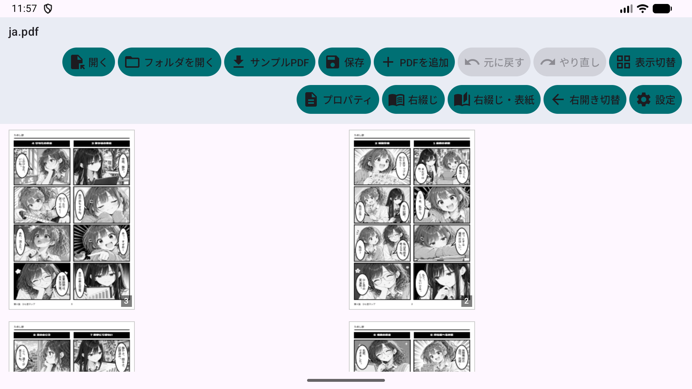
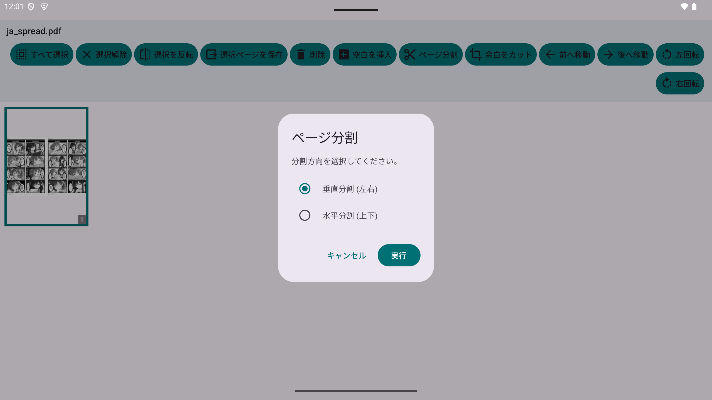
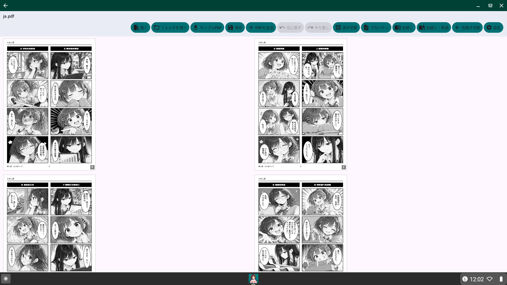

# 見開きPDFユーティリティ (Android)

Android向けの強力で直感的なPDFユーティリティアプリです。仕事・学業・提出書類のPDF整理や、**見開き（2ページスプレッド表示）**による自炊書籍・漫画の管理に最適です。

[**Webサイト (日本語)**](https://tyamada.github.io/MihirakiPDFUtility_Android/index_ja.html) | [**English Website**](https://tyamada.github.io/MihirakiPDFUtility_Android/) | [**English README (README.md)**](README.md)

## リリース候補

候補版：<!-- current-app-version:start -->1.2.7 (23)<!-- current-app-version:end -->。クローズドテスト公開とPlay経由の更新確認は未完了です。

サンプルPDFは第1話順／最新話順に並べ替えでき、再起動後も選択した順序を保持します。ダウンロード元は本アプリ自身の公開サンプルです。

開発用の `scripts/run_device_tests_and_save.py --serial <端末番号>` は既定で端末情報の収集だけを行います。Debug試験は専用端末で `--mode debug` を明示し、Play版のある端末は保護します。手動確認を自動で合格にしたり、検証一覧を書き換えたりしません。[リリース準備報告書](docs/CLOSED_TEST_RELEASE_PROGRESS_1.2.7_23.ja.md)も参照してください。

## 🚀 主な機能

| 機能 | 説明 |
| :--- | :--- |
| 📖 **見開き表示** | 2ページを横並びで表示。日本の書籍や漫画に合わせた「右開き（RTL）」にも完全対応しています。 |
| ✂️ **スマートページ分割** | 見開き1ページを2つのページに分割。垂直（左右）と水平（上下）の両方の分割方向をサポートします。 |
| 🔀 **ドラッグ＆ドロップ並べ替え** | サムネイルをドラッグするだけでページ順序を整理。直感的なインターフェースで編集が捗ります。 |
| ➕ **結合と追加** | 複数のPDFファイルを1つに結合したり、既存のPDFにページを追加したりできます。 |
| 🖥️ **アダプティブメニューとカスタマイズ** | 画面幅840dp以上の水平メニューバーと、小さい画面向けのカテゴリ別オーバーフローメニューの自動切り替え、およびオプションからのツールバーボタンカスタマイズ。 |
| 🔒 **セキュリティ＆プライバシー** | アプリ内プライバシーポリシー画面、パスワード保護、メタデータ編集、自動サニタイズ、ローカル監査ログ。 |
| 🌟 **インタラクティブチュートリアル** | 初回起動時の分かりやすいガイド画面。サンプルPDFの即時試用や、ヘルプからのいつでも再確認に対応。 |
| 🔍 **総合診断・ベンチマーク** | アプリ内で動的生成するテストPDFを活用した総合診断・ベンチマークテストの実行と、端末内ローカル監査ログ（24時間自動保持・外部送信なし）の確認が可能。 |
| 💻 **クロスデバイス対応** | スマートフォン、タブレット、折りたたみ端末、ChromeOS（デスクトップ環境）で快適に動作。 |
| 🔄 Play Store 更新確認 | 起動時の自動更新確認およびバージョン画面からの手動更新確認（レートリミット機能付き）、更新検出時のツールバーへの動的更新ボタン表示。 |

### 機能紹介

### 画面イメージ

各デバイスでの動作例：

| デバイス | 表示 | 画像 |
| :--- | :--- | :--- |
| **スマートフォン** | 見開き表示 |  |
| **タブレット** | ページ分割 |  |
| **ChromeOS** | デスクトップUI |  |

## 🌐 多言語サポート

イタリア語、日本語、英語、韓国語、中国語、ドイツ語、フランス語、スペイン語、ポルトガル語、ベトナム語、タガログ語、ネパール語、インドネシア語など14言語に対応しています。

## サンプルPDF

アプリでお試しいただけるサンプルPDF（マンガ）をダウンロードできます：

- [THE TRY-IT CLUB EPISODE 1: THE BREAK-TIME MAP (English) - Komairo Hiyori](https://github.com/tyamada/MihirakiPDFUtility_Android/raw/main/sample/tameshibu_episode1_2_en.pdf)
- [THE TRY-IT CLUB EPISODE 2: ROOM TO GROW (English) - Komairo Hiyori](https://github.com/tyamada/MihirakiPDFUtility_Android/raw/main/sample/tameshibu_episode2_2_en.pdf)
- [ためし部 第１話 ひと息マップ (Japanese) - こまいろ日和](https://github.com/tyamada/MihirakiPDFUtility_Android/raw/main/sample/tameshibu_episode1_2_ja.pdf)
- [ためし部 第２話 机、ひろがる。 (Japanese) - こまいろ日和](https://github.com/tyamada/MihirakiPDFUtility_Android/raw/main/sample/tameshibu_episode2_2_ja.pdf)
- [해봄부 제1화 한숨 돌림 지도 (Korean) - 코마이로 히요리](https://github.com/tyamada/MihirakiPDFUtility_Android/raw/main/sample/tameshibu_episode1_2_ko.pdf)
- [해봄부제2화 책상이 넓어지다 (Korean) - 코마이로 히요리](https://github.com/tyamada/MihirakiPDFUtility_Android/raw/main/sample/tameshibu_episode2_2_ko.pdf)
- [试试社 第1话 歇口气地图 (Chinese (Simplified)) - 小真彩日和](https://github.com/tyamada/MihirakiPDFUtility_Android/raw/main/sample/tameshibu_episode1_2_zh_cn.pdf)
- [试试社 第2话 桌子变大了 (Chinese (Simplified)) - 小真彩日和](https://github.com/tyamada/MihirakiPDFUtility_Android/raw/main/sample/tameshibu_episode2_2_zh_cn.pdf)
- [試試社 第1話 (Chinese (Traditional)) - 小舞樓日和](https://github.com/tyamada/MihirakiPDFUtility_Android/raw/main/sample/tameshibu_episode1_2_zh_tw.pdf)
- [試試社 第2話 (Chinese (Traditional)) - 小舞樓日和](https://github.com/tyamada/MihirakiPDFUtility_Android/raw/main/sample/tameshibu_episode2_2_zh_tw.pdf)
- [DER PROBIERCLUB FOLGE 1 (German) - Komairo Hiyori](https://github.com/tyamada/MihirakiPDFUtility_Android/raw/main/sample/tameshibu_episode1_2_de.pdf)
- [DER PROBIERCLUB FOLGE 2 (German) - Komairo Hiyori](https://github.com/tyamada/MihirakiPDFUtility_Android/raw/main/sample/tameshibu_episode2_2_de.pdf)
- [LE CLUB DES ESSAIS EPISODE 1 (French) - Komairo Hiyori](https://github.com/tyamada/MihirakiPDFUtility_Android/raw/main/sample/tameshibu_episode1_2_fr.pdf)
- [LE CLUB DES ESSAIS EPISODE 2 (French) - Komairo Hiyori](https://github.com/tyamada/MihirakiPDFUtility_Android/raw/main/sample/tameshibu_episode2_2_fr.pdf)
- [EL CLUB DE PRUEBA EPISODIO 1 (Spanish) - Komairo Hiyori](https://github.com/tyamada/MihirakiPDFUtility_Android/raw/main/sample/tameshibu_episode1_2_es.pdf)
- [EL CLUB DE PRUEBA EPISODIO 2 (Spanish) - Komairo Hiyori](https://github.com/tyamada/MihirakiPDFUtility_Android/raw/main/sample/tameshibu_episode2_2_es.pdf)
- [IL CLUB DI PROVA EPISODIO 1 (Italian) - Komairo Hiyori](https://github.com/tyamada/MihirakiPDFUtility_Android/raw/main/sample/tameshibu_episode1_2_it.pdf)
- [IL CLUB DI PROVA EPISODIO 2 (Italian) - Komairo Hiyori](https://github.com/tyamada/MihirakiPDFUtility_Android/raw/main/sample/tameshibu_episode2_2_it.pdf)
- [O CLUBE DE TESTE EPISÓDIO 1 (Portuguese) - Komairo Hiyori](https://github.com/tyamada/MihirakiPDFUtility_Android/raw/main/sample/tameshibu_episode1_2_pt.pdf)
- [O CLUBE DE TESTE EPISÓDIO 2 (Portuguese) - Komairo Hiyori](https://github.com/tyamada/MihirakiPDFUtility_Android/raw/main/sample/tameshibu_episode2_2_pt.pdf)
- [CÂU LẠC BỘ THỬ NGHIỆM TẬP 1 (Vietnamese) - Komairo Hiyori](https://github.com/tyamada/MihirakiPDFUtility_Android/raw/main/sample/tameshibu_episode1_2_vi.pdf)
- [CÂU LẠC BỘ THỬ NGHIỆM TẬP 2 (Vietnamese) - Komairo Hiyori](https://github.com/tyamada/MihirakiPDFUtility_Android/raw/main/sample/tameshibu_episode2_2_vi.pdf)
- [KLUB PERCOBAAN EPISODE 1 (Indonesian) - Komairo Hiyori](https://github.com/tyamada/MihirakiPDFUtility_Android/raw/main/sample/tameshibu_episode1_2_id.pdf)
- [KLUB PERCOBAAN EPISODE 2 (Indonesian) - Komairo Hiyori](https://github.com/tyamada/MihirakiPDFUtility_Android/raw/main/sample/tameshibu_episode2_2_id.pdf)
- [ANG SUBOK CLUB EPISODE 1 (Filipino) - Komairo Hiyori](https://github.com/tyamada/MihirakiPDFUtility_Android/raw/main/sample/tameshibu_episode1_2_fil.pdf)
- [ANG SUBOK CLUB EPISODE 2 (Filipino) - Komairo Hiyori](https://github.com/tyamada/MihirakiPDFUtility_Android/raw/main/sample/tameshibu_episode2_2_fil.pdf)
- [परीक्षण क्लब एपिसोड १ (Nepali) - Komairo Hiyori](https://github.com/tyamada/MihirakiPDFUtility_Android/raw/main/sample/tameshibu_episode1_2_ne.pdf)
- [परीक्षण क्लब एपिसोड २ (Nepali) - Komairo Hiyori](https://github.com/tyamada/MihirakiPDFUtility_Android/raw/main/sample/tameshibu_episode2_2_ne.pdf)
- [THE TRY-IT CLUB EPISODE 3 (English) - Komairo Hiyori](https://github.com/tyamada/MihirakiPDFUtility_Android/raw/main/sample/tameshibu_episode3_en.pdf)
- [ためし部 第３話 (Japanese) - こまいろ日和](https://github.com/tyamada/MihirakiPDFUtility_Android/raw/main/sample/tameshibu_episode3_ja.pdf)
- [해봄부 제3화 (Korean) - 코마이로 히요리](https://github.com/tyamada/MihirakiPDFUtility_Android/raw/main/sample/tameshibu_episode3_ko.pdf)
- [试试社 第3话 (Chinese (Simplified)) - 小真彩日和](https://github.com/tyamada/MihirakiPDFUtility_Android/raw/main/sample/tameshibu_episode3_zh_cn.pdf)
- [試試社 第3話 (Chinese (Traditional)) - 小舞樓日和](https://github.com/tyamada/MihirakiPDFUtility_Android/raw/main/sample/tameshibu_episode3_zh_tw.pdf)

### サンプルPDFのライセンス (CC BY 4.0)

『ためし部』第1話・第2話
© 2026 こまいろ日和

本作品のうち、公開者が著作権その他の許諾対象となる権利を有する部分を、[Creative Commons 表示 4.0 国際（CC BY 4.0）](https://creativecommons.org/licenses/by/4.0/)で提供します。

再利用時は、作品名、作者名「こまいろ日和」、原作品の公開元、ライセンスへのリンクを表示し、変更した場合はその旨を明示してください。

本作品は、文章・画像の制作および翻訳に生成AIを使用しています。フォントなど第三者に権利がある素材には、それぞれのライセンスが適用されます。著作権等による保護を受けない部分の利用を、この表示によって制限するものではありません。

## 技術スタック

*   **UI**: Jetpack Compose (Material 3)
*   **アーキテクチャ**: MVVM (ViewModel, StateFlow)
*   **PDF処理**: [PdfBox-Android](https://github.com/TomRoush/PdfBox-Android)
*   **言語**: Kotlin

## ライセンス

Apache License 2.0

## リリースおよびドキュメント更新ルール

App Bundle ビルド前に、最新の仕様に合わせて `README.md`、`LICENSE`、`docs/*.html`、`store_listing/metadata*.txt` を更新するルールが設定されています。詳細は [RELEASE_RULES.md](RELEASE_RULES.md) を参照してください。Gradle (`preBundleDocumentationCheck`) によりビルド前の自動検証が行われます。
