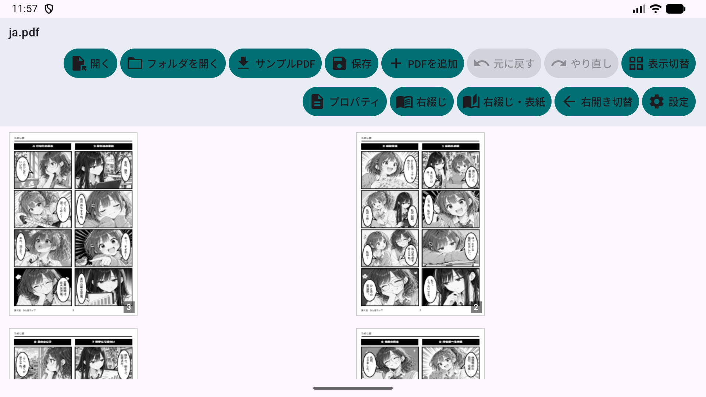
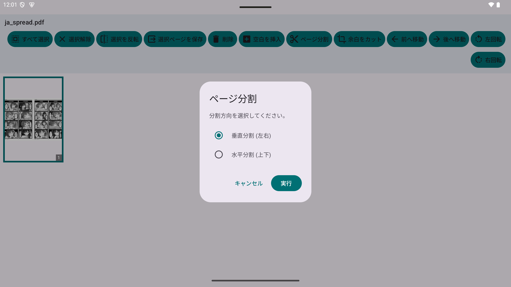
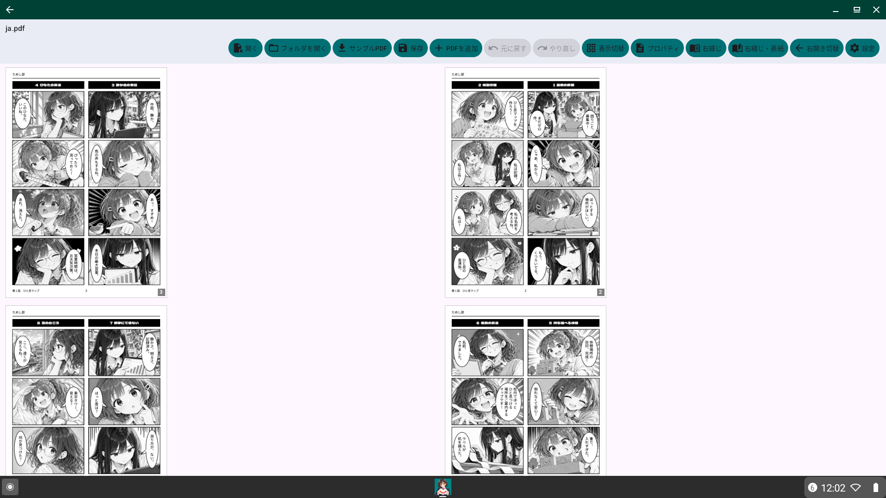

# 見開きPDFユーティリティ (Android)

製品版は一般公開前です。2026-11-23時点の公開状況とXのテスト案内は[公開準備記録](docs/PRODUCTION_DISTRIBUTION_PLAN_2026-11-15.ja.md)を参照してください。

[](LICENSE)

Android向けの強力で直感的なPDFユーティリティアプリです。仕事・学業・提出書類のPDF整理や、**見開き（2ページスプレッド表示）**による自炊書籍・漫画の管理に最適です。

[**Webサイト (日本語)**](https://tyamada.github.io/MihirakiPDFUtility_Android/index_ja.html) | [**English Website**](https://tyamada.github.io/MihirakiPDFUtility_Android/) | [**English README (README.md)**](README.md)


## 動画ガイド

日本語と英語の動画ガイドです。YouTubeで開きます。

- [日本語の説明動画（5本・春日部つむぎ）](https://www.youtube.com/playlist?list=PLNNwgShEZ8RA)
- [英語の説明動画（5本）](https://www.youtube.com/playlist?list=PLa-QGEwHSDRo)

## 最新クローズドテスト版

版情報：<!-- current-app-version:start -->1.2.16 (32)<!-- current-app-version:end -->。1.2.16候補では保存候補名のPDF拡張子重複とツールバーの文字切れを修正しています。最新版JSONを検証してサンプル一覧を取得し、取得できない場合は保存済み一覧または同梱一覧を利用します。検証済みの取得済みPDFは保持します。無料のこよみバッジは2027年12月31日（日本時間）まで自動取得でき、取得済みは期限後も保持します。取得通知は手動で閉じ、アプリ情報から拡大画像と説明を確認できます。Alpha 1.2.15（31）は2026年11月20日8:57（日本時間）に選択したテスターへ公開されました。

サンプル漫画は14言語・17言語地域区分×3話。地域名は原語と英語名を併記し、英語名順に表示します。第1話順／最新話順の選択は再起動後も保持します。

[配信報告書](docs/CLOSED_TEST_RELEASE_PROGRESS_1.2.9_25.ja.md) ／ [実機再確認手順](docs/CLOSED_TEST_DEVICE_CHECKLIST_1.2.9_25.ja.md)。

## 🚀 主な機能

| 機能 | 説明 |
| :--- | :--- |
| 📖 **見開き表示** | 2ページを横並びで表示。日本の書籍や漫画に合わせた「右開き（RTL）」にも完全対応しています。 |
| ✂️ **スマートページ分割** | 見開き1ページを2つのページに分割。垂直（左右）と水平（上下）の両方の分割方向をサポートします。 |
| 🔀 **ドラッグ＆ドロップ並べ替え** | サムネイルをドラッグするだけでページ順序を整理。直感的なインターフェースで編集が捗ります。 |
| ➕ **結合と追加** | 複数のPDFファイルを1つに結合したり、既存のPDFにページを追加したりできます。 |
| 🖥️ **アダプティブメニューとカスタマイズ** | 画面幅840dp以上の水平メニューバーと、小さい画面向けのカテゴリ別スクロール可能なボトムシートメニューの自動切り替え、およびオプションからのツールバーボタンカスタマイズ。 |
| 🔒 **セキュリティ＆プライバシー** | アプリ内プライバシーポリシー画面、パスワード保護、メタデータ編集、自動サニタイズ、ローカル監査ログ。 |
| 🌟 **インタラクティブチュートリアル** | 初回起動時の分かりやすいガイド画面。サンプルPDFの即時試用や、ヘルプからのいつでも再確認に対応。 |
| 🔍 **総合診断・ベンチマーク** | アプリ内で動的生成するテストPDFを活用した総合診断・ベンチマークテストの実行と、端末内ローカル監査ログ（24時間自動保持・外部送信なし）の確認が可能。 |
| 💻 **クロスデバイス対応** | スマートフォン、タブレット、折りたたみ端末、ChromeOS（デスクトップ環境）で快適に動作。 |
| 🔄 Play Store 更新確認 | 起動時の自動更新確認およびバージョン画面からの手動更新確認（レートリミット機能付き）、更新検出時のツールバーへの動的更新ボタン表示。 |

### 機能紹介


### 画面イメージ

各デバイスでの動作例：

| デバイス | 表示 | 画像 |
| :--- | :--- | :--- |
| **スマートフォン** | 見開き表示 |  |
| **タブレット** | ページ分割 |  |
| **ChromeOS** | デスクトップUI |  |

## 🌐 多言語サポート

イタリア語、日本語、英語、韓国語、中国語、ドイツ語、フランス語、スペイン語、ポルトガル語、ベトナム語、タガログ語、ネパール語、インドネシア語など14言語に対応しています。

## サンプルPDF

アプリでお試しいただけるサンプルPDF（マンガ）をダウンロードできます：

14言語・17言語地域区分×3話の全51冊です。スペイン／中南米、ブラジル／ポルトガル、台湾／香港を区別して選べます。香港版は標準書面語で、口語の広東語版ではありません。取得時にサイズとSHA-256を検証し、旧PDFは保持します。

以下のリンクは英語の言語名順、各言語内は第1〜3話の順に掲載しています。

[サンプルPDFのダウンロード](https://tyamada.github.io/manga-prompt-kit/samples/ja/)

### サンプルPDFのライセンス (CC BY 4.0)

『ためし部』第1〜3話
© 2026 こまいろ日和

本作品のうち、公開者が著作権その他の許諾対象となる権利を有する部分を、[Creative Commons 表示 4.0 国際（CC BY 4.0）](https://creativecommons.org/licenses/by/4.0/)で提供します。

再利用時は、作品名、作者名「こまいろ日和」、原作品の公開元、ライセンスへのリンクを表示し、変更した場合はその旨を明示してください。

本作品は、文章・画像の制作および翻訳に生成AIを使用しています。フォントなど第三者に権利がある素材には、それぞれのライセンスが適用されます。著作権等による保護を受けない部分の利用を、この表示によって制限するものではありません。

## 技術スタック

*   **UI**: Jetpack Compose (Material 3)
*   **アーキテクチャ**: MVVM (ViewModel, StateFlow)
*   **PDF処理**: [PdfBox-Android](https://github.com/TomRoush/PdfBox-Android)
*   **言語**: Kotlin

## 開発者向けセットアップ

### 開発環境とビルド・インストール

- JDK 21（Gradle DaemonはJetBrains製JDK 21を使用。未導入時はGradleのtoolchain resolverが取得します）
- Android SDK Platform 36、Build Tools 36.0.0、Platform Tools
- Android Studioで開く場合は、このリポジトリのGradle/AGPバージョンに対応する版を使用してください。
- SDKはAndroid StudioのSDK Manager、または[公式のコマンドラインツール](https://developer.android.com/tools/sdkmanager)で導入します。SDKライセンスへの同意が必要です。

```bash
git clone https://github.com/tyamada/MihirakiPDFUtility_Android.git
cd MihirakiPDFUtility_Android
# JAVA_HOMEはJDK 21、ANDROID_HOMEは自身のAndroid SDKディレクトリに設定
sdkmanager "platforms;android-36" "build-tools;36.0.0" "platform-tools"
sdkmanager --licenses
./gradlew assembleDebug lintDebug testDebugUnitTest
# USBデバッグを許可した端末、または起動済みエミュレータ1台にインストール
./gradlew installDebug
```

Windowsでは`gradlew.bat`を使用します。SDKの場所は`ANDROID_HOME`、または追跡対象外の`local.properties`の`sdk.dir=/absolute/path/to/Android/sdk`で指定します。Android Studioではプロジェクトを開いてGradle Sync後、Runを実行できます。Android 8.0（API 26）以上が必要です。

APKの出力先は`app/build/outputs/apk/debug/app-debug.apk`です。Debugは自動生成の開発用鍵で署名され、作者の秘密鍵は不要です。Play版と署名が異なるため、同じアプリIDで上書きできません。試験用端末を使用してください。

### Release署名

自分の配布用鍵を作成します。作者の鍵は公開・配布しません。

```bash
keytool -genkeypair -v -keystore /absolute/private/path/release-key.jks -alias release -keyalg RSA -keysize 3072 -validity 10000
```

パスワードは対話入力します。追跡対象外の`local.properties`に以下を追加してください（パスワード欄は自分の値に置換）。

```properties
signing.storeFile=/absolute/private/path/release-key.jks
signing.storePassword=YOUR_STORE_PASSWORD
signing.keyAlias=release
signing.keyPassword=YOUR_KEY_PASSWORD
```

`./gradlew bundleRelease`で`app/build/outputs/bundle/release/app-release.aab`を生成します。鍵・パスワード・`local.properties`・署名済み成果物をGitへ登録しないでください。補助Pythonスクリプトの依存は必要に応じて`requirements-play-console.txt`を参照してください。通常のアプリビルドにPlay Console認証は不要です。

## ライセンス

Apache License 2.0

## リリースおよびドキュメント更新ルール

App Bundle ビルド前に、最新の仕様に合わせて `README.md`、`LICENSE`、`docs/*.html`、`store_listing/metadata*.txt` を更新するルールが設定されています。詳細は [RELEASE_RULES.md](RELEASE_RULES.md) を参照してください。Gradle (`preBundleDocumentationCheck`) によりビルド前の自動検証が行われます。

### サンプルPDFの配布

51件のサンプル漫画PDFは制作資料リポジトリの固定[GitHub Release](https://tyamada.github.io/manga-prompt-kit/samples/ja/)から配布します。旧アプリ向けのGitHub Pages上のPDFと既存URLは維持します。[移行・検証記録](docs/SAMPLE_PDF_RELEASE_MIGRATION.ja.md)を参照してください。


[2026-11-12 配布先移行・検証記録](docs/SAMPLE_PDF_DISTRIBUTION_MIGRATION_20261112.ja.md)

[サンプルv2の実装・検証記録](docs/SAMPLE_PDF_V2_UPDATE.ja.md)

サンプル案内の更新手順：https://github.com/tyamada/manga-prompt-kit/blob/main/docs/sample-download-maintenance.md
